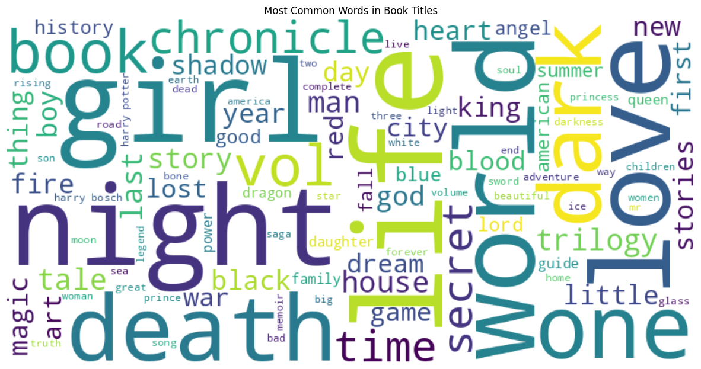
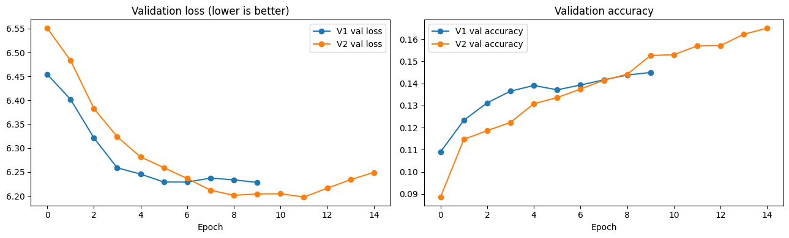

# Word-Level LSTM Book Title Generator

An LSTM language model that predicts the next word of book titles (GoodBooks-10k) and generates new ones. Beyond building the model, the project **found and fixed a data-preparation bug** that inflated the baseline's metrics, and redesigned generation so titles are complete and non-repetitive.

📓 **Notebook:** [`lstm_book_title_generator.ipynb`](lstm_book_title_generator.ipynb)

---

## The problem

- **Data:** 10,000 book titles from GoodBooks-10k, lowercased and stripped to letters (80/20 train/test split).
- **Setup:** vocabulary of the 2,500 most frequent words, inputs padded to 19 tokens, predict the next word (2,500-way softmax).
- **Baseline:** Embedding (100) → LSTM (100) → Dropout → LSTM (100) → Dropout → Dense (softmax), 10 epochs.



## Key findings

**1. The baseline overfit from the first epoch.** Training accuracy climbed to 59% while validation accuracy plateaued at 23% and **validation loss rose every epoch** (6.58 → 9.71), worse than guessing uniformly among 2,500 words.

**2. Most of the training data was duplicated.** The original sequence builder always looped a fixed 19 times, so a 3-word title produced "the hunger → games" 18 times. Result: **152,000 training sequences, only 22,556 unique.**

**3. Fixing the data mattered more than the architecture.** I rebuilt the data with one example per prefix, created a clean test set, and **re-evaluated the baseline on it** for a fair comparison:

| Model | Top-1 | Top-5 | Perplexity | BLEU |
|---|---|---|---|---|
| Baseline (original test) | 0.248 | 0.349 | 2,085 | 0.191 |
| Baseline (clean test) | 0.133 | 0.243 | 2,529 | 0.133 |
| V1: clean data | 0.144 | 0.261 | 357 | 0.144 |
| **V2: + masking, dropout 0.3, early stopping** | **0.152** | **0.277** | **349** | **0.152** |

- About **half of the baseline's accuracy came from duplicates**, and its clean-test perplexity was worse than random guessing.
- Removing duplicates cut perplexity **~7×**; masking padding (`mask_zero=True`) and regularization added a smaller, consistent gain.
- BLEU equals Top-1 on clean data: for single-word predictions, BLEU is just an exact-match score.



**4. Temperature trades coherence for diversity, but can't fix a weak model.** At T = 0.2 outputs were near-identical and repetitive ("past past"); at T = 1.0 they varied with title-like fragments; at T = 2.0 grammar collapsed. Distinct outputs out of 10: 7 / 10 / 10.

**5. Making titles complete and coherent:**

| Problem | Fix |
|---|---|
| Titles never stopped | Retrained with an end-of-title token and stopped when it's predicted |
| Repeated words ("the the", "past past") | Blocked repeated content words and immediate repeats |
| Too repetitive or too random | Top-k (20) + nucleus (p = 0.9) sampling at T = 0.8 |
| Dangling endings ("…the wisdom of") | Trimmed trailing function words, title-cased output |
| Weak candidates | Generated 8 candidates and kept the most probable one that ended naturally |

| Seed | Before (greedy) | After |
|---|---|---|
| A song of | A song of the gang being book club inheritance cycle | **A Song Of The Art Of Death** |
| The secret | The secret lairds the clues guide to writing the | **The Secret Of The Book** |
| Love | Love the afterlife to the kingdom of french | **Love Of The Dark** |

**100% of titles now end naturally**, with no repeated words or dangling endings. The trade-off: reranking by probability made titles more generic ("of the", "the world" recur), so coherence improved at the cost of creativity.

## Running it

```bash
pip install -r requirements.txt
jupyter notebook lstm_book_title_generator.ipynb
```

The dataset is downloaded automatically from the public GoodBooks-10k repository. A GPU runtime (e.g. Colab T4) is recommended.

## Tech stack

Python · TensorFlow / Keras · NumPy · pandas · NLTK (BLEU) · Matplotlib / Seaborn · WordCloud
